# Simply Security Ecosystem — Ansible Automation Suite

This directory contains the Ansible automation suite designed to deploy, configure, and orchestrate the `simply_*` security ecosystem across Debian nodes.

---

## 1. Architecture & Security Model

The deployment enforces least privilege, network isolation, and decoupled host/container execution:

```mermaid
flowchart TD
    subgraph Host ["Debian Host (Systemd & Kernel)"]
        PS["Portsentry (Root)"]
        FWS["/etc/firewall/firewall.report (0700)"]
        FWB["/etc/firewall/firewall.launch.block.ip (sudo)"]
        FWA["/etc/firewall/firewall.launch.allow.ip (add | del | ban + ss -K / conntrack)"]
        FWREV["/etc/firewall/firewall.revoke.whitelist (emergency CLI -> kernel + Vault)"]
        FWR["/etc/firewall/firewall reload (sudo)"]
        SSHD["SSHD (hookexecutor user on 10.123.0.1)"]
        SD1["Systemd: firewall.service (boot)"]
        SD2["Systemd: firewall-set-ip.service (post-docker)"]
        SD3["Systemd: firewall-update-blocklists.timer (03:00)"]
        SD4["Systemd: firewall-daily-reload.timer (04:00)"]
        SD5["Systemd: simply-containers-update.timer (Mon 05:00)"]
    end

    subgraph NetIsolate ["Docker Network: isolate (10.123.0.0/16) - enable_icc=false"]
        F2B["linuxserver/fail2ban (read_only)"]
        SFRM["simply_fw_rules_manager (:3000 -> 127.0.0.1:3004, isolate-only)"]
        SHE["simply_hook_executor (:3000 -> 127.0.0.1:3001)"]
        SIV["simply_ip_vault (:3000 -> 127.0.0.1:3000)"]
        SIE["simply_ip_exporter (:3002 -> 127.0.0.1:3002, Optional, isolate-only)"]
        SWL["simply_white_list (:3004 -> 127.0.0.1:3005, Optional)"]
        SP["socket_proxy (read-only Docker socket)"]
        PG["PostgreSQL (Optional container / SQLite)"]
    end

    subgraph NetExt ["Docker Network: ext (10.124.0.0/16) - Internet Access"]
        SIS["simply_ip_sync (:3003, Optional)"]
        EXT_OPT["Optional commented/opt-in ext on SHE / SIV / SWL"]
        ABUSE["AbuseIPDB API v2"]
    end

    PS -->|"Direct Host Exec (as Root)"| FWS
    F2B -->|"actionban X-API-Key POST firewall-report"| SHE
    SFRM -->|"CANONICAL_V1 firewall-reload / docker-update-containers"| SHE
    SHE -->|"Pinned SSH key auth to 10.123.0.1"| SSHD
    SSHD -->|"sudo /etc/firewall/firewall.report"| FWS
    SSHD -->|"sudo /etc/firewall/firewall.launch.block.ip"| FWB
    SSHD -->|"sudo /etc/firewall/firewall.launch.allow.ip"| FWA
    SSHD -->|"sudo /etc/firewall/firewall reload"| FWR
    FWS -->|"CANONICAL_V1 POST /api/ban (unit IPv4/IPv6)"| SIV
    SWL -->|"Daughter API key (Main_Whitelist only)"| SIV
    SIV -->|"Webhook Firewall Block (send_normalized_ipv6=true => /48)"| SHE
    SIV -->|"Webhook Whitelist Allow -> firewall-allow-ip (send_normalized_ipv6=false)"| SHE
    SIV -->|"Webhook Whitelist Revoke -> firewall-revoke-ip (send_normalized_ipv6=false)"| SHE
    FWREV -->|"1. Immediate del/ban + ss -K/conntrack"| FWA
    FWREV -->|"2. CANONICAL_V1 DELETE /api/ips (+ /api/ban on --ban)"| SIV
    SIV -.->|"Webhook AbuseIPDB Report (requires vault_allow_ext_network=true)"| ABUSE
    SIS -->|"Sync Public Feeds + Optional AbuseIPDB"| SIV
    SIE -->|"Fetch Banlist + Whitelist Groups via CANONICAL_V1 API"| SIV
    SD3 -->|"firewall.tools: generate_list / generate_whitelist / finalize_blocklists"| SIE
```



### Key Principles:
1. **Network Namespace & ICC Isolation (Zero Compose `ports:`):**
   - `simply_fw_rules_manager`, `simply_ip_exporter`, `fail2ban`, `socket_proxy`, and `simply_postgres` run strictly on the `isolate` Docker bridge (`10.123.0.0/16` + IPv6 `fd10:1993:1000:1199::2:0/112`, `enable_icc: false`) with no `ext` interface.
   - `simply_hook_executor`, `simply_ip_vault`, and optional `simply_white_list` also stay `isolate`-only by default; their `ext:` network entries remain commented out in `docker-compose.yml` unless `*_allow_ext_network: true` is explicitly requested. `simply_ip_sync` attaches to `isolate` + `ext` so it can pull upstream threat feeds.
   - `docker-compose.yml` bans host `ports:` bindings completely (`expose:` only) so `docker-proxy` and default Docker chains cannot bypass the firewall.
   - Inter-container communication (`dockerAccessBetweenThem`) and host loopback forwarding (`localDockerTCP` on `127.0.0.1:3000..3005` over `isolate`) are managed solely by Linux `iptables` / `ip6tables` chains via `/etc/firewall/firewall`.
   - `/etc/docker/daemon.json` enables IPv6 (`ipv6: true`, `ip6tables: true`, `fixed-cidr-v6`, and IPv6 `default-address-pools`).
2. **Privilege Separation via `hookexecutor`:**
   - Dedicated unprivileged system user `hookexecutor` on the host.
   - Authenticated exclusively via a pinned Ed25519 SSH keypair uploaded into `simply_hook_executor`.
   - Sudoers rules `/etc/sudoers.d/hookexecutor` restrict `NOPASSWD` execution to:
     - `/etc/firewall/firewall.report`
     - `/etc/firewall/firewall.launch.block.ip`
     - `/etc/firewall/firewall.launch.allow.ip`
     - `/etc/firewall/firewall reload`
     - `/etc/firewall/firewall reload-rules`
     - `/etc/init.d/firewall reload`
     - `/etc/init.d/firewall reload-rules`
     - `/usr/bin/systemctl start simply-containers-update.service`
3. **IPv6 `/48` Normalization vs Exact Reporting & Scoped Whitelists:**
   - `firewall.report` sends the **exact attacker unit IPv6** (`2001:db8:abcd::1234`, without `/48`) to `simply_ip_vault`.
   - `simply_ip_vault` runtime setting `normalize_ipv6_to_48` (default `true`, synced via `PUT /api/settings`) stores bare host IPv6 attackers normalized as `/48` while keeping exact addresses available for webhook dispatch:
     - `Firewall Block` webhook (`send_normalized_ipv6: true`, `CANONICAL_V1`) dispatches the `/48` network to `simply_hook_executor` (`firewall-block-ip` -> `/etc/firewall/firewall.launch.block.ip`), which handles both bare IPv6 and IPv6 CIDRs (`is_ipv6_net`) without duplicating `/48`.
     - `AbuseIPDB Report` webhook (`send_normalized_ipv6: false`, configured automatically when `abuseipdb_api_key` is provided) sends the exact unit IPv6 so AbuseIPDB does not reject CIDRs with `422 Unprocessable Entity`.
     - Optional `simply_white_list` + Vault whitelist orchestration creates a `whitelist`-typed Vault group (`vault_whitelist_group_name`, default `Main_Whitelist`), provisions a least-privilege Daughter key scoped strictly to that group, attaches `Whitelist Allow` (`IP_ADD,IP_UPDATE` -> `firewall-allow-ip`) & dedicated `Whitelist Revoke` (`IP_DELETE` -> `firewall-revoke-ip`, `mode` defaulting to `del`, `add` disallowed) webhooks with `send_normalized_ipv6: false` calling `/etc/firewall/firewall.launch.allow.ip`, and targets `firewall_whitelist_ipset_name` (`special_guest` by default via `firewall.rules.special` for country-open access without granting `good_ip` admin bypass).
     - **Fast Whitelist Deletion Stack:** `firewall.launch.allow.ip` supports `add | del | ban` (plus `ipset="all"` on `del`/`ban` to purge across `special_guest`, `good_ip`, and any `firewall.allow.*`/`to_allow.*` files while protecting `IPAutor` & local host IPs), normalizes `/32` & `/128` variants, and terminates established connections immediately via shared `kill_active_connections` (`ss -K` with bracketed IPv6 + `conntrack -D`, bypassing `ESTABLISHED,RELATED` rules). `/etc/firewall/firewall.revoke.whitelist <ip> [cause] [ipset|all] [--ban]` executes immediate kernel cutoff first and then synchronizes `DELETE /api/ips` (+ `POST /api/ban` on `--ban`) to `simply_ip_vault`, while `exporter_whitelist_ttl_seconds` (`15s`) keeps exporter caches short-lived.
4. **Resilient Blocklist & Whitelist Fetching (`firewall.tools` & `firewall.set.ip`):**
   - `firewall.get.list` delegates downloads and aggregation to `generate_list`, `generate_whitelist`, and `finalize_blocklists` in `/etc/firewall/firewall.tools`.
   - Existing `.ip.4` / `.ip.6` banlist caches are preserved intact if an upstream download fails, while `generate_whitelist` treats valid HTTP 200 empty whitelist feeds as full revocation (`empty_removes_existing=1`) and syncs `to_allow.<ipset>.ipv4`/`.ipv6` atomically into ipsets (`good_ip` or `special_guest`) via `firewall.set.ip`.

---

## 2. Pinned Container IPs & Loopback Mapping (`localDockerTCP`)

`docker-compose.yml` uses `expose:` only (no `ports:`) and pins static IPv4/IPv6 addresses (`docker_pin_container_ips: true`, `docker_pin_container_ipv6: true`) in the reserved high host range (`.250.10..18` / `:fa10..fa18`) so container IPs never drift across restarts or collide with Docker dynamic IPAM allocations (`.0.2+`). When `firewall.settings` is active, `/etc/firewall/firewall` maps host loopback `127.0.0.1` ports to `isolate` container bridges via `localDockerTCP`:

| Service | Host Loopback (`localDockerTCP`) | Pinned `isolate` IPv4 / IPv6 | `ext` Network & Pinned IPv4 / IPv6 | Port (`expose`) | Purpose |
| :--- | :--- | :--- | :--- | :--- | :--- |
| **`simply_fw_rules_manager`** | `127.0.0.1:3004` | `10.123.250.10` / `fd10:1993:1000:1199::2:fa10` | `— (isolate-only)` | `3000` | Firewall configuration & rule deployment UI/API |
| **`simply_hook_executor`** | `127.0.0.1:3001` | `10.123.250.11` / `fd10:1993:1000:1199::2:fa11` | `10.124.250.11` / `fd10:1993:1000:1199::1:fa11` *(opt)* | `3000` | SSH/local hook runner (`firewall-report`, `firewall-block-ip`, `firewall-allow-ip`, `firewall-revoke-ip`, `firewall-reload`, `docker-update-containers`) |
| **`simply_ip_vault`** | `127.0.0.1:3000` | `10.123.250.12` / `fd10:1993:1000:1199::2:fa12` | `10.124.250.12` / `fd10:1993:1000:1199::1:fa12` *(opt)* | `3000` | Central IP banlist/whitelist Vault & webhook dispatcher |
| **`simply_ip_sync`** | `127.0.0.1:3003` | `10.123.250.13` / `fd10:1993:1000:1199::2:fa13` | `10.124.250.13` / `fd10:1993:1000:1199::1:fa13` | `3003` | External threat feed aggregator & Vault syncer (optional) |
| **`simply_ip_exporter`** | `127.0.0.1:3002` | `10.123.250.14` / `fd10:1993:1000:1199::2:fa14` | `— (isolate-only)` | `3002` | Raw IP/CIDR banlist & whitelist feed exporter (`/feed/v1/<token>/list.txt`, optional) |
| **`socket_proxy`** | `—` | `10.123.250.15` / `fd10:1993:1000:1199::2:fa15` | `—` | `2375` | Read-only Docker API proxy for `simply_fw_rules_manager` |
| **`simply_postgres`** | `—` | `10.123.250.16` / `fd10:1993:1000:1199::2:fa16` | `—` | `5432` | Optional containerized PostgreSQL database |
| **`fail2ban`** | `—` | `10.123.250.17` / `fd10:1993:1000:1199::2:fa17` | `—` | `—` | Log-based intrusion prevention calling `simply_hook_executor` |
| **`simply_white_list`** | `127.0.0.1:3005` | `10.123.250.18` / `fd10:1993:1000:1199::2:fa18` | `10.124.250.18` / `fd10:1993:1000:1199::1:fa18` *(opt)* | `3004` | Optional temporary whitelist portal with Vault Daughter key |

> Host scripts (`firewall.report`, `firewall.get.list`) resolve live container bridge IPs on `isolate` via `get_container_ipv4_on_network` in `firewall.tools` and fall back to the pinned `isolate` IP (or `127.0.0.1` if pinning is disabled). `firewall.rules.special` also restricts `isolate` SSH access strictly to `simply_hook_executor`'s pinned IP (`10.123.250.11` / `fd10:1993:1000:1199::2:fa11`). *(opt)* services leave `ext` commented out in `docker-compose.yml` unless their `*_allow_ext_network` variable is `true`.

---

## 3. Systemd Decoupling vs Legacy Cron

SysVinit scripts in crontab frequently triggered race conditions at boot due to locking contention (`/run/xtables.lock`) and unready Docker bridges. This automation moves everything to native systemd units:

| Systemd Unit | Schedule / Trigger | Purpose |
| :--- | :--- | :--- |
| **`firewall.service`** | Boot (`Before=network.target`) | Initializes base chains, anti-spoofing, and core filter rules. |
| **`firewall-set-ip.service`** | Post-boot (`After=network-online.target docker.service`) | Runs `firewall reload-rules` (`localDockerTCP` / inter-container rules), then loads IP sets (`good_ip`, `bad_ip`, GeoIP) with atomic swaps. |
| **`firewall-update-blocklists.timer`** | Daily at `03:00` | Downloads external threat feeds and whitelists, then reloads `firewall.set.ip`. |
| **`firewall-daily-reload.timer`** | Daily at `04:00` | Performs a full firewall restart and reload to guarantee state integrity. |
| **`simply-containers-update.timer`** | Weekly on Monday at `05:00` | Pulls updated container images and reloads firewall rules automatically. |

---

## 4. Directory Layout

```
ansible/
├── ansible.cfg                          # Optimal defaults (pipelining, SSH caching, smart facts)
├── inventory/
│   ├── hosts.ini.example                # Inventory template for root/sudo SSH connections
│   └── group_vars/
│       └── all.yml                      # Central variable declarations with sane defaults
├── playbooks/
│   ├── site.yml                         # Master interactive / headless deployment playbook
│   ├── 01_host_prerequisites.yml        # Host packages, Debian codename, docker repo, hookexecutor
│   ├── 02_docker_setup.yml              # Docker engine, daemon.json IPv6, ext & isolate networks
│   ├── 03_firewall_systemd.yml          # /etc/firewall deployment & systemd units
│   ├── 04_containers_deploy.yml         # Container ecosystem (compose, isolated secrets, master_key)
│   └── 05_vault_integration.yml         # Hooks, API keys, webhooks, exporter & sync orchestration
├── roles/
│   ├── common/                          # Codename detection (trixie fallback), core packages, sysctl
│   ├── docker/                          # Docker apt repository, engine, daemon.json, networks
│   ├── hookexecutor/                    # Unprivileged host user, SSH keypair, sudoers rule
│   ├── portsentry/                      # Portsentry setup and KILL_RUN_CMD configuration
│   ├── firewall/                        # Script deployment, -w 5 locks, systemd units & timers
│   ├── containers/                      # Compose generation, UID-scoped secrets & bootstrap log parsing
│   └── vault_integration/               # Full API orchestration across Vault, HookExecutor, FW, Sync, Exporter
└── README.md                            # Complete documentation (this file)
```

---

## 5. Quickstart Guide

### Prerequisites
- Target host running **Debian** (Bullseye, Bookworm, Trixie, or Forky/Sid).
- Ansible `>= 2.14` installed on the controller machine.
- SSH access as `root` or a user with `sudo` privileges.

### Step 1: Prepare Inventory
Copy `inventory/hosts.ini.example` to `inventory/hosts.ini`:
```bash
cp inventory/hosts.ini.example inventory/hosts.ini
```

Edit `inventory/hosts.ini` with your target server IP:
```ini
[security_nodes]
my_server ansible_host=203.0.113.10 ansible_user=root ansible_ssh_private_key_file=~/.ssh/id_ed25519
```

### Step 2: Run Deployment

#### Mode A: Interactive Execution
Prompts you for database choice, PostgreSQL version, Vault topology, IPv6 `/48` normalization, operator whitelist, optional AbuseIPDB key, optional components (`simply_ip_sync`, `simply_ip_exporter`, `simply_white_list` + whitelist hook target), and explicit `ext` network toggles:
```bash
ansible-playbook playbooks/site.yml
```

#### Mode B: Headless / Automated Execution
Pass variables directly on the command line or via `inventory/group_vars/all.yml`:
```bash
ansible-playbook playbooks/site.yml -e "database_type=sqlite vault_mode=local vault_normalize_ipv6_to_48=true deploy_simply_ip_sync=true deploy_simply_ip_exporter=true deploy_simply_white_list=true"
```

#### Mode C: Step-by-Step Execution
Execute individual steps independently:
```bash
# Run host prerequisites only
ansible-playbook playbooks/01_host_prerequisites.yml

# Run Docker and network setup only
ansible-playbook playbooks/02_docker_setup.yml

# Deploy firewall scripts and systemd units
ansible-playbook playbooks/03_firewall_systemd.yml

# Deploy Docker Compose stack
ansible-playbook playbooks/04_containers_deploy.yml

# Configure Hook Executor, Vault webhooks, Whitelist Daughter key, Exporter & Sync
ansible-playbook playbooks/05_vault_integration.yml
```

---

## 6. Configuration Reference (`group_vars/all.yml`)

| Variable | Default Value | Description |
| :--- | :--- | :--- |
| `firewall_scripts_src_dir` | `"{{ playbook_dir }}/../../scripts_etc"` | Source directory on controller for core firewall scripts (`scripts_etc`). |
| `target_debian_codename_fallback` | `"trixie"` | Fallback codename if `/etc/os-release` codename is unlisted. |
| `database_type` | `"sqlite"` | Database backend: `sqlite`, `postgres_container`, or `postgres_external`. |
| `postgres_version` | `"18"` | Docker image tag for PostgreSQL (e.g., `16`, `17`, `18`). |
| `vault_mode` | `"local"` | Vault deployment: `local` (container on host) or `remote` (existing vault). |
| `vault_group_name` | `"Main_Ban"` | Default Vault group for host threat reporting (`Portsentry` / `Fail2Ban`). |
| `vault_normalize_ipv6_to_48` | `true` | Sync local `simply_ip_vault` `/api/settings` `normalize_ipv6_to_48`. |
| `vault_enable_ban_webhook` | `true` | Configure `"Firewall Block"` webhook (`send_normalized_ipv6=true`) on `simply_ip_vault`. |
| `abuseipdb_api_key` | `""` | Optional AbuseIPDB v2 API key; enables `AbuseIPDB Report` webhook (`send_normalized_ipv6=false`) and `simply_ip_sync` `abuseipdb` feed. |
| `abuseipdb_report_categories` | `"14,18"` | Default AbuseIPDB report categories (Port Scan, Brute-Force). |
| `abuseipdb_confidence_minimum` | `90` | Minimum AbuseIPDB confidence score when pulling blacklist into `simply_ip_sync`. |
| `deploy_simply_ip_sync` | `false` | Deploy & pre-configure threat feed aggregator (`simply_ip_sync`) with Serv1 groups. |
| `deploy_simply_ip_exporter` | `false` | Deploy raw IP/CIDR feed exporter (`simply_ip_exporter`) & wire into `firewall.get.list`. |
| `deploy_simply_white_list` | `false` | Deploy optional `simply_white_list` portal with a strictly scoped Vault Daughter key (`Main_Whitelist` only). |
| `configure_vault_whitelist` | `""` | Configure Vault whitelist group, `Whitelist Allow`/`Revoke` webhooks & exporter feed (`""` defaults to `deploy_simply_white_list`). |
| `vault_whitelist_group_name` | `"Main_Whitelist"` | Vault group (`group_type: "whitelist"`) synchronized with `simply_white_list` & `firewall.launch.allow.ip`. |
| `firewall_whitelist_ipset_name` | `"special_guest"` | Target ipset base (`special_guest` for country-open access in `firewall.rules.special`, or `good_ip` for admin bypass). |
| `exporter_endpoint_name` | `"Firewall Banlist"` | Name of the auto-created banlist `simply_ip_exporter` endpoint. |
| `exporter_endpoint_groups` | `"{{ vault_group_name }}..."` | Vault groups exported to `firewall.get.list` (`Main_Ban` + `external_banlist,vpn` when sync enabled). |
| `exporter_whitelist_endpoint_name` | `"Firewall Whitelist"` | Name of the auto-created whitelist `simply_ip_exporter` endpoint (`vault_whitelist_group_name`). |
| `exporter_whitelist_ttl_seconds` | `15` | Short cache TTL (seconds) for the whitelist exporter feed so revoked entries drop rapidly. |
| `hook_executor_allow_ext_network` | `false` | Attach `simply_hook_executor` to `ext` (`false` leaves `ext:` commented out in `docker-compose.yml`). |
| `vault_allow_ext_network` | `false` | Attach `simply_ip_vault` to `ext` (`false` leaves `ext:` commented out; required `true` for external peering or AbuseIPDB). |
| `white_list_allow_ext_network` | `false` | Attach `simply_white_list` to `ext` (`false` leaves `ext:` commented out; host proxy still reaches `127.0.0.1:3005`). |
| `operator_whitelist_ips` | `[]` | Admin IPs added to `IPAutor` in `firewall.settings`. |
| `sshd_port` | `22` | Fallback SSH port if not detected in `/etc/ssh/sshd_config`. |
| `docker_net_isolate_ipv4_subnet` | `"10.123.0.0/16"` | IPv4 subnet for the isolated bridge network. |
| `docker_net_ext_ipv4_subnet` | `"10.124.0.0/16"` | IPv4 subnet for the external bridge network. |
| `docker_pin_container_ips` | `true` | Pin static IPv4/IPv6 addresses (`docker_container_ips`) inside `docker-compose.yml`. |
| `docker_pin_container_ipv6` | `true` | Pin static `ipv6_address` alongside `ipv4_address` (requires IPv6 IPAM on bridges). |
| `docker_container_ips` | `.250.10..18` / `:fa10..fa18` | Per-container static IPs on `isolate` (all) and `ext` (opt/sync only). |
| `blocklist_update_schedule` | `"*-*-* 03:00:00"` | Systemd OnCalendar schedule for blocklist updates. |
| `daily_reload_schedule` | `"*-*-* 04:00:00"` | Systemd OnCalendar schedule for daily full firewall reload. |
| `container_update_schedule` | `"Mon *-*-* 05:00:00"` | Systemd OnCalendar schedule for weekly container upgrades. |

---

## 7. Verification & Operational Commands

### Check Systemd Services & Timers:
```bash
# Verify active timers
systemctl list-timers | grep -E 'firewall|simply'

# Inspect firewall service status
systemctl status firewall.service
systemctl status firewall-set-ip.service

# View daily reload journal
journalctl -u firewall-daily-reload.service -n 50
```

### Check Container Stack:
```bash
cd /etc/firewall
docker compose ps
docker compose logs -f fail2ban simply_hook_executor simply_ip_vault
```

### Inspect Kernel Firewall & IP Sets:
```bash
# List active IP sets
ipset list -n

# Check bad_ip / bad_ip6 set members
ipset list bad_ip | head -n 10
ipset list bad_ip6 | head -n 10

# Test Hook Executor SSH connectivity from container to host
docker exec -it simply_hook_executor ssh -i /config/id_ed25519 -p 22 hookexecutor@10.123.0.1 "whoami"

# Emergency host whitelist revocation (cuts kernel ipset + active sockets/conntrack, then syncs Vault DELETE + optional ban)
/etc/firewall/firewall.revoke.whitelist 203.0.113.20 "Emergency_Revoke" all
/etc/firewall/firewall.revoke.whitelist 203.0.113.20 "Compromised_Guest" all --ban
```
