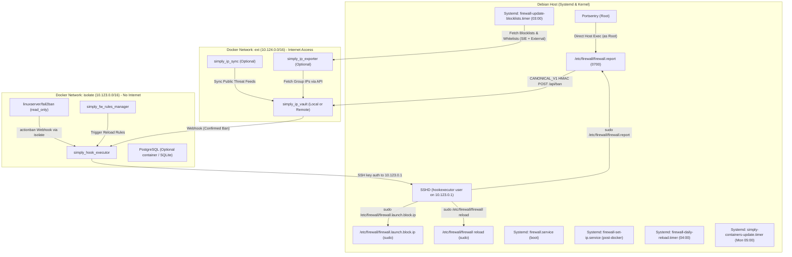

# Simply Security Ecosystem — Ansible Automation Suite

This directory contains the production-grade Ansible automation suite designed to deploy, configure, and orchestrate the `simply_*` security ecosystem across Debian nodes.

---

## 1. Architecture & Security Model

The deployment enforces a strict principle of least privilege, network isolation, and service decoupling:



### Key Principles:
1. **Network Namespace Isolation:**
   - `simply_fw_rules_manager` and `fail2ban` are attached **exclusively** to the `isolate` Docker bridge (`10.123.0.0/16`, `enable_icc: false`, `enable_ip_masquerade: false`). They have zero direct outbound access to the public internet.
   - `simply_hook_executor` resides on `isolate` (+ optional `ext` only if communicating with external remote systems).
   - Inbound traffic to exposed services is controlled exclusively by Linux `iptables` / `ip6tables` PREROUTING and FORWARD chains.
2. **Privilege Separation via `hookexecutor`:**
   - Dedicated unprivileged system user `hookexecutor` on the host.
   - Authenticated exclusively via an Ed25519 SSH keypair stored inside `simply_hook_executor`.
   - Sudoers rules `/etc/sudoers.d/hookexecutor` are restricted to `NOPASSWD` execution of:
     - `/etc/firewall/firewall.report`
     - `/etc/firewall/firewall.launch.block.ip`
     - `/etc/firewall/firewall reload`
     - `/etc/firewall/firewall reload-rules`
3. **Fail2Ban Hardening:**
   - Container runs in `read_only: true`.
   - Actions and jail configurations are mounted read-only.
   - Banning triggers a webhook to `simply_hook_executor`, which executes `firewall.report` through the restricted SSH user.

---

## 2. Systemd Decoupling vs Legacy Cron

SysVinit scripts in crontab frequently triggered race conditions at boot due to locking contention (`/run/xtables.lock`) and unready Docker bridges. This automation moves everything to native systemd units:

| Systemd Unit | Schedule / Trigger | Purpose |
| :--- | :--- | :--- |
| **`firewall.service`** | Boot (`Before=network.target`) | Initializes base chains, anti-spoofing, and core filter rules. |
| **`firewall-set-ip.service`** | Post-boot (`After=network-online.target docker.service`) | Loads IP sets (`good_ip`, `bad_ip`, GeoIP) and atomic swaps. |
| **`firewall-update-blocklists.timer`** | Daily at `03:00` | Downloads external threat feeds and whitelists, then reloads `firewall.set.ip`. |
| **`firewall-daily-reload.timer`** | Daily at `04:00` | Performs a full firewall restart and reload to guarantee state integrity. |
| **`simply-containers-update.timer`** | Weekly on Monday at `05:00` | Pulls updated container images and reloads firewall rules automatically. |

---

## 3. Directory Layout

```
ansible/
├── ansible.cfg                          # Optimal defaults (pipelining, SSH caching, smart facts)
├── inventory/
│   ├── hosts.ini.example                # Inventory template for root/sudo SSH connections
│   └── group_vars/
│       └── all.yml                      # Central variable declarations with sane defaults
├── playbooks/
│   ├── site.yml                         # Master interactive / headless deployment playbook
│   ├── 01_host_prerequisites.yml        # Host packages, Debian codename, docker repo
│   ├── 02_docker_setup.yml              # Docker engine, daemon.json IPv6, ext & isolate networks
│   ├── 03_firewall_systemd.yml          # /etc/firewall deployment & systemd units
│   ├── 04_containers_deploy.yml         # Container ecosystem (compose, isolate/ext networks)
│   └── 05_vault_integration.yml        # Vault peering, webhooks & Fail2ban action wiring
├── roles/
│   ├── common/                          # Codename detection (trixie fallback), core packages, sysctl
│   ├── docker/                          # Docker apt repository, engine, daemon.json, networks
│   ├── hookexecutor/                    # Unprivileged host user, SSH keypair, sudoers rule
│   ├── portsentry/                      # Portsentry setup and KILL_RUN_CMD configuration
│   ├── firewall/                        # Script deployment, -w 5 locks, systemd units & timers
│   ├── containers/                      # Compose generation, mandatory + optional services
│   └── vault_integration/               # Vault groups, API keys, webhook configs & Fail2ban action
└── README.md                            # Complete documentation (this file)
```

---

## 4. Quickstart Guide

### Prerequisites
- Target host running **Debian** (Bullseye, Bookworm, Trixie, or Forky/Sid).
- Ansible `>= 2.14` installed on the controller machine.
- SSH access as `root` or a user with `sudo` privileges.

### Step 1: Prepare Inventory
Copy `inventory/hosts.ini.example` to `inventory/hosts.ini`:
```bash
cp inventory/hosts.ini.example inventory/hosts.ini
```

Edit `inventory/hosts.ini` with your target server IP:
```ini
[security_nodes]
my_server ansible_host=203.0.113.10 ansible_user=root ansible_ssh_private_key_file=~/.ssh/id_ed25519
```

### Step 2: Run Deployment

#### Mode A: Interactive Execution
Prompts you for database choice, PostgreSQL version, Vault topology, and optional components:
```bash
ansible-playbook playbooks/site.yml
```

#### Mode B: Headless / Automated Execution
Pass variables directly on the command line or via `inventory/group_vars/all.yml`:
```bash
ansible-playbook playbooks/site.yml -e "database_type=sqlite vault_mode=local deploy_simply_ip_sync=false"
```

#### Mode C: Step-by-Step Execution
Execute individual steps or tags independently:
```bash
# Run host prerequisites only
ansible-playbook playbooks/01_host_prerequisites.yml

# Run Docker and network setup only
ansible-playbook playbooks/02_docker_setup.yml

# Deploy firewall scripts and systemd units
ansible-playbook playbooks/03_firewall_systemd.yml

# Deploy Docker Compose stack
ansible-playbook playbooks/04_containers_deploy.yml

# Configure Vault integration and webhooks
ansible-playbook playbooks/05_vault_integration.yml
```

---

## 5. Configuration Reference (`group_vars/all.yml`)

| Variable | Default Value | Description |
| :--- | :--- | :--- |
| `firewall_scripts_src_dir` | `"{{ playbook_dir }}/../../scripts_etc"` | Source directory on controller for core firewall scripts (`scripts_etc`). |
| `target_debian_codename_fallback` | `"trixie"` | Fallback codename if `/etc/os-release` codename is unlisted. |
| `database_type` | `"sqlite"` | Database backend: `sqlite`, `postgres_container`, or `postgres_external`. |
| `postgres_version` | `"18"` | Docker image tag for PostgreSQL (e.g., `16`, `17`, `18`). |
| `vault_mode` | `"local"` | Vault deployment: `local` (container on host) or `remote` (existing vault). |
| `vault_group_name` | `"Main_Ban"` | Default group for host threat reporting. |
| `deploy_simply_ip_sync` | `false` | Deploy threat feed fetcher container (`simply_ip_sync`). |
| `deploy_simply_ip_exporter` | `false` | Deploy raw IP/CIDR feed exporter container (`simply_ip_exporter`). |
| `sshd_port` | `22` | Host SSH port (auto-detected from `/etc/ssh/sshd_config`). |
| `docker_net_isolate_ipv4_subnet` | `"10.123.0.0/16"` | IPv4 subnet for the isolated bridge network. |
| `docker_net_ext_ipv4_subnet` | `"10.124.0.0/16"` | IPv4 subnet for the external bridge network. |
| `blocklist_update_schedule` | `"*-*-* 03:00:00"` | Systemd OnCalendar schedule for blocklist updates. |
| `daily_reload_schedule` | `"*-*-* 04:00:00"` | Systemd OnCalendar schedule for daily full firewall reload. |
| `container_update_schedule` | `"Mon *-*-* 05:00:00"` | Systemd OnCalendar schedule for weekly container upgrades. |

---

## 6. Verification & Operational Commands

### Check Systemd Services & Timers:
```bash
# Verify active timers
systemctl list-timers | grep -E 'firewall|simply'

# Inspect firewall service status
systemctl status firewall.service
systemctl status firewall-set-ip.service

# View daily reload journal
journalctl -u firewall-daily-reload.service -n 50
```

### Check Container Stack:
```bash
cd /srv/dockers/simply_firewall
docker compose ps
docker compose logs -f fail2ban simply_hook_executor
```

### Inspect Kernel Firewall & IP Sets:
```bash
# List active IP sets
ipset list -n

# Check bad_ip set members count
ipset list bad_ip | head -n 10

# Test Hook Executor SSH connectivity from container to host
docker exec -it simply_hook_executor ssh -i /config/id_ed25519 -p 22 hookexecutor@10.123.0.1 "whoami"
```
